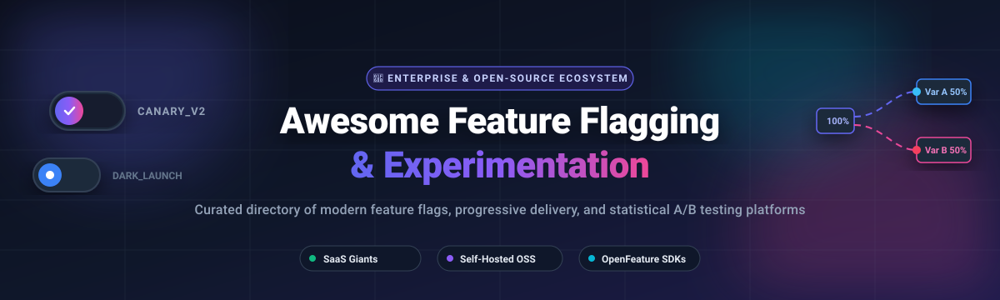

# 🚩 Awesome Feature Flagging & Experimentation 🧪

**The definitive curated index of top Feature Flagging, Feature Toggle, Progressive Delivery, and Experimentation (A/B Testing) platforms — comparing SaaS commercial titans and self-hosted open-source software (OSS) solutions.**

[Market Overview](#-sector-overview--market-dynamics) • [SaaS Comparison](#-saas--hosted-platforms) • [Open-Source Solutions](#-open-source-software) • [Comparison Matrix](#-comparison-at-a-glance) • [Contributing](#-contributing)

---

## 📑 Table of Contents

- [🌐 Sector Overview & Market Dynamics](#-sector-overview--market-dynamics)
- [🟦 SaaS / Hosted Platforms](#-saas--hosted-platforms)
  - [🏢 Enterprise & SaaS Comparison Matrix](#-enterprise--saas-comparison-matrix)
  - [🔍 SaaS Platform Deep Dive](#-saas-platform-deep-dive)
    - [1. Split (Harness)](#1-split-harness)
    - [2. LaunchDarkly](#2-launchdarkly)
    - [3. Statsig](#3-statsig)
    - [4. CloudBees Feature Management](#4-cloudbees-feature-management)
    - [5. Optimizely Feature Experimentation](#5-optimizely-feature-experimentation)
    - [6. ConfigCat](#6-configcat)
- [🟩 Open-Source Software](#-open-source-software)
  - [⭐ Open-Source Leaderboard (Ranked by Stars)](#-open-source-leaderboard-ranked-by-stars)
  - [🛠️ Open-Source Project Deep Dive](#️-open-source-project-deep-dive)
    - [1. PostHog](#1-posthog)
    - [2. Unleash](#2-unleash)
    - [3. GrowthBook](#3-growthbook)
    - [4. Flagsmith](#4-flagsmith)
    - [5. Flipt](#5-flipt)
    - [6. Flipper](#6-flipper)
    - [7. Flagr](#7-flagr)
    - [8. GO Feature Flag](#8-go-feature-flag)
    - [9. FeatBit](#9-featbit)
    - [10. FeatureProbe](#10-featureprobe)
    - [11. FF4J (Feature Flags for Java)](#11-ff4j-feature-flags-for-java)
    - [12. Bucketeer](#12-bucketeer)
- [📊 Comparison at a Glance](#-comparison-at-a-glance)
- [📈 Star History](#-star-history)
- [💖 Support & Sponsorship](#-support--sponsorship)
- [🤝 Contributing](#-contributing)
- [📄 License](#-license)

---

## 🌐 Sector Overview & Market Dynamics

The global feature flagging and experimentation software market is estimated at **$1.4B–$1.7B** and is projected to expand toward **$5.5B–$6.0B** over the next decade at a 16–18% CAGR, powered by widespread adoption of Continuous Delivery (CI/CD), trunk-based development, and progressive rollout safety practices.

The sector exhibits a **hybrid market structure**:
- **Concentrated at the enterprise summit**, where category leaders (Harness/Split, LaunchDarkly, Statsig, and Optimizely) command large-scale enterprise contracts, complex compliance governance, and heavy evaluation volumes.
- **Moderately fragmented across mid-market, SMBs, and developer tiers**, where transparent consumption-based tools (ConfigCat), full-stack product suites (PostHog), and warehouse-native experimentation platforms (GrowthBook) aggressively capture market share from traditional high-cost incumbents.

---

## 🟦 SaaS / Hosted Platforms

Commercial, managed feature management and experimentation services offering cloud-hosted control planes, low-latency edge delivery networks, and enterprise-grade SLA backing.

### 🏢 Enterprise & SaaS Comparison Matrix

> **Note:** The table is sorted descending by company size (Valuation / ARR).

| Platform 🚀 | Company Size (Valuation / ARR) 📈 | Pricing (Starting Tier) 💳 | Free Tier & Free Trial Limits 🎁 | Key Deployment Model ⚙️ |
|:---|:---|:---|:---|:---|
| **[Split (Harness)](https://www.harness.io/products/feature-flags)** | **$5.5B Valuation** (~$250M ARR) | **$33 / user / month** (Starting Team Plan) | **Free Forever:** 2 developer seats, up to 25,000 client-side MAUs, unlimited flags & environments; **30-day full-feature trial** | Cloud SaaS & Hybrid Agent |
| **[LaunchDarkly](https://launchdarkly.com/)** | **$3.0B Valuation** (~$150M–$190M ARR) | **~$10 / month** ($10/service connection + $8.33/1k MAUs on Foundation plan) | **Free Forever (Developer):** Unlimited team seats, 5 service connections/mo, 1,000 client-side MAUs, 100k experimentation MAUs; **14-day Enterprise trial** | Global Edge CDN & Relay Proxy |
| **[Statsig](https://statsig.com/)** | **$1.1B Valuation** (~$40M ARR) | **$150 / month** (Pro Tier, includes 5M metered events; +$0.05/1k events thereafter) | **Free Forever (Developer):** 2,000,000 metered events/mo, 50,000 session replays/mo, unlimited seats, unlimited feature flag & config evaluations | Cloud SaaS & Warehouse-Native |
| **[CloudBees Feature Management](https://www.cloudbees.com/products/feature-management)** | **$1.0B Valuation** (~$150M ARR) | **$30 – $50 / user / month** (Team / Foundation Tier) | **Free Forever (Community):** Capped at 5 users, up to 100,000 client-side evaluators, 7-day log retention; **14-day Enterprise trial** | Cloud SaaS, Hybrid & On-Premises |
| **[Optimizely Feature Experimentation](https://www.optimizely.com/products/feature-experimentation/)** | **~$600M Acquisition Valuation** (~$400M+ DXP ARR) | **~$35,000 / year** (~$2,916/mo starting enterprise contract) | **Free Forever (Rollouts Tier):** Unlimited feature flags, targeted delivery rollouts, open-source SDKs, limited to 1 concurrent A/B test | Cloud SaaS & Edge Engine |
| **[ConfigCat](https://configcat.com/)** | **Bootstrapped / Private SMB** (~$2M–$5M ARR est.) | **$95 / month** (Pro Plan billed annually, or $110/mo billed monthly; unlimited team seats) | **Free Forever:** ~5,000,000 config JSON downloads/mo, 20 GB CDN traffic, 2 products, 2 environments/product, 10 feature flags/product, unlimited user seats | Multi-CDN Edge Distributed |

---

### 🔍 SaaS Platform Deep Dive

#### 1. Split (Harness)
- **Primary Type:** Feature flags + impact-driven experimentation (now Harness FME).
- **Architecture & Ecosystem:** Acquired by Harness in 2024 and fully integrated with Harness Software Delivery platform. Combines automated canary rollouts, verification gates, and continuous deployment workflows.
- **Best Suited For:** Engineering teams looking for unified CI/CD delivery pipelines alongside feature flags and statistical metric tracking.

#### 2. LaunchDarkly
- **Primary Type:** Enterprise feature management & dynamic configuration.
- **Architecture & Ecosystem:** Category pioneer with deep role-based access controls (RBAC), multi-environment workflows, audit tracking, and 30+ SDKs with LaunchDarkly Relay Proxy architecture.
- **Best Suited For:** Large, highly-regulated enterprises demanding proven 99.999% uptime, strict compliance, and granular release approvals.

#### 3. Statsig
- **Primary Type:** All-in-one feature flags + Bayesian A/B testing + product analytics.
- **Architecture & Ecosystem:** Founded by former Facebook engineering leaders. Offers both cloud-hosted and warehouse-native evaluation (Snowflake, BigQuery, Databricks) with automated pulse metrics and metric lift calculations.
- **Best Suited For:** High-growth product and data teams wanting experimentation, flag gates, and analytics unified in one interface.

#### 4. CloudBees Feature Management
- **Primary Type:** Enterprise DevOps feature governance (formerly Rollout.io).
- **Architecture & Ecosystem:** Native integration with Jenkins, CloudBees CI/CD, and hybrid deployment environments. Delivers real-time configuration updates with strict air-gapped on-premise governance.
- **Best Suited For:** Enterprise defense, banking, and healthcare organizations operating complex hybrid-cloud or on-premise infrastructures.

#### 5. Optimizely Feature Experimentation
- **Primary Type:** Server-side feature flagging and high-throughput experimentation.
- **Architecture & Ecosystem:** Successor to Optimizely Full Stack. Deep statistical computation engine (Stats Engine) with false discovery rate control. Integrates across Optimizely Digital Experience Platform (DXP).
- **Best Suited For:** Digital marketing, e-commerce, and product teams prioritizing advanced experimentation math.

#### 6. ConfigCat
- **Primary Type:** Simple, highly-predictable feature toggle service.
- **Architecture & Ecosystem:** Evaluates flags client-side via lightweight static JSON configurations distributed across global CDNs. Completely decoupled from user counts and seat licenses.
- **Best Suited For:** Startups and development teams needing straightforward toggle switches without complex MAU billing traps.

---

## 🟩 Open-Source Software

Self-hosted, transparent, and community-driven feature flagging and experimentation platforms. These tools allow full control over your data, zero third-party data transmission, and custom infrastructure setups.

### ⭐ Open-Source Leaderboard (Ranked by Stars)

| Repository & Platform 📦 | GitHub_Stars 🌟 | Stack / Language 💻 | License 📜 | Specialization 🎯 |
|:---|:---|:---|:---|:---|
| **[PostHog](https://github.com/PostHog/posthog)** |  | Python, TypeScript, ClickHouse | MIT (Open Core) | Product analytics, session replays, feature flags & experimentation suite |
| **[Unleash](https://github.com/Unleash/unleash)** |  | Node.js, TypeScript, PostgreSQL | Apache-2.0 (Open Core) | Battle-tested enterprise feature toggle service with Unleash Edge proxy |
| **[GrowthBook](https://github.com/growthbook/growthbook)** |  | TypeScript, Go, Python, MongoDB | MIT (Open Core) | Warehouse-native experimentation, CUPED statistics, Bayesian & frequentist |
| **[Flagsmith](https://github.com/Flagsmith/flagsmith)** |  | Python, Django, PostgreSQL | BSD-3-Clause (Open Core) | Flagging, remote configuration, user segmentation & OpenFeature native |
| **[Flipt](https://github.com/flipt-io/flipt)** |  | Go, TypeScript, SQLite / Postgres | GPL-3.0 / Commercial | GitOps-native, high-performance feature flagging container runtime |
| **[Flipper](https://github.com/flippercloud/flipper)** |  | Ruby | MIT | Performant and flexible feature flipping engine for Ruby and Rails |
| **[Flagr](https://github.com/openflagr/flagr)** |  | Go, Vue.js | Apache-2.0 | Microservice-driven feature flagging, dynamic configuration & A/B testing |
| **[GO Feature Flag](https://github.com/thomaspoignant/go-feature-flag)** |  | Go | MIT | Lightweight cloud-native solution using simple file/S3 configs & OpenFeature |
| **[FeatBit](https://github.com/featbit/featbit)** |  | C# (.NET), TypeScript | MIT | High-performance 100% open-source feature flag tool with real-time UI |
| **[FeatureProbe](https://github.com/FeatureProbe/FeatureProbe)** |  | Rust, Java, TypeScript | Apache-2.0 | Full-featured toggle management, canary rollouts, and experimentation UI |
| **[FF4J](https://github.com/ff4j/ff4j)** |  | Java | Apache-2.0 | Established Feature Flags for Java / Spring ecosystem with JMX & REST APIs |
| **[Bucketeer](https://github.com/bucketeer-io/bucketeer)** |  | Go, TypeScript, MySQL | Apache-2.0 | Cloud-native feature flagging & A/B testing platform created by CyberAgent |

---

### 🛠️ Open-Source Project Deep Dive

#### 1. PostHog
- **Stack:** Python, TypeScript, ClickHouse, PostgreSQL, Redis 
- **License:** MIT core
- **Overview:** An all-in-one product OS combining behavioral analytics, session recording, feedback surveys, error tracking, and feature flags with multivariate A/B testing.
- **Best For:** Engineering teams looking for unified telemetry and feature management in a single platform.

#### 2. Unleash
- **Stack:** Node.js, TypeScript, PostgreSQL
- **License:** Apache-2.0 core
- **Overview:** A pioneer in open-source feature management. Features Unleash Edge for sub-millisecond local caching, custom targeting strategies, flexible kill switches, and 25+ official SDKs.
- **Best For:** Scaled self-hosted deployments seeking enterprise-grade security and air-gapped support.

#### 3. GrowthBook
- **Stack:** TypeScript, Python, MongoDB / Warehouse-native
- **License:** MIT core
- **Overview:** The premier open-source experimentation platform. Directly queries warehouses (Snowflake, BigQuery, Redshift, ClickHouse) without duplicating events, delivering CUPED statistical variance reduction.
- **Best For:** Data science and experimentation teams conducting advanced scientific A/B tests.

#### 4. Flagsmith
- **Stack:** Python, Django, PostgreSQL
- **License:** BSD-3-Clause core
- **Overview:** Straightforward feature toggle and remote configuration tool. Offers official OpenFeature providers, environment segmentation, audit logging, and streamlined Docker/Kubernetes deployment.
- **Best For:** Organizations seeking an easily self-hosted platform with a permissive BSD license.

#### 5. Flipt
- **Stack:** Go, TypeScript
- **License:** GPL-3.0 / Commercial Core
- **Overview:** Built from the ground up for modern GitOps workflows. Stores configurations directly in Git repositories, integrates with Kubernetes CRDs, and compiles into zero-dependency Go binaries.
- **Best For:** DevOps teams implementing GitOps and infrastructure-as-code feature delivery.

#### 6. Flipper
- **Stack:** Ruby
- **License:** MIT
- **Overview:** The definitive feature toggle library for the Ruby and Rails community. Extremely performant with zero-downtime database backing (ActiveRecord, Redis, Mongo, Memory).
- **Best For:** Ruby and Ruby on Rails web applications needing simple, high-speed toggles.

#### 7. Flagr
- **Stack:** Go, Vue.js
- **License:** Apache-2.0
- **Overview:** Lightweight, stateless dynamic evaluation engine providing evaluation APIs, user cohort assignment, and multivariate A/B/n test allocation.
- **Best For:** Microservice environments needing a standalone HTTP/gRPC evaluation service.

#### 8. GO Feature Flag
- **Stack:** Go
- **License:** MIT
- **Overview:** A zero-infrastructure, OpenFeature-compliant solution. Reads flag configurations directly from GitHub, S3, Google Cloud Storage, or Kubernetes ConfigMaps without database maintenance.
- **Best For:** Cloud-native and Kubernetes-centric architectures seeking a lean evaluation service.

#### 9. FeatBit
- **Stack:** C# (.NET Core), TypeScript
- **License:** MIT
- **Overview:** Real-time feature toggle and progressive rollout platform built on .NET Core. Delivers sub-millisecond evaluation with full UI controls, segmentation, and approval workflows.
- **Best For:** .NET / C# enterprise ecosystems wanting complete on-premise autonomy.

#### 10. FeatureProbe
- **Stack:** Rust, Java, TypeScript
- **License:** Apache-2.0
- **Overview:** High-performance feature toggle service utilizing Rust evaluation engines for extreme throughput and low latency in distributed architectures.
- **Best For:** Latency-sensitive high-traffic mobile and web applications.

#### 11. FF4J (Feature Flags for Java)
- **Stack:** Java
- **License:** Apache-2.0
- **Overview:** Longstanding standard in the Java ecosystem (Spring, Spring Boot, Quarkus). Provides JMX metrics, audit logging, and integrations with JDBC, MongoDB, Redis, and Consul.
- **Best For:** Enterprise Java and Spring Boot backends needing embedded feature flag evaluation.

#### 12. Bucketeer
- **Stack:** Go, TypeScript, MySQL
- **License:** Apache-2.0
- **Overview:** Developed and battle-tested by CyberAgent in Japan. OpenFeature-compliant platform with integrated mobile SDKs and real-time metric tracking.
- **Best For:** Large mobile-first applications and international enterprises.

---

## 📊 Comparison at a Glance

| Software 🏷️ | License 📄 | Delivery Model ☁️ | Self-Hosted 🏠 | Advanced Stats 📈 | Best For 🎯 |
|:---|:---|:---|:---:|:---:|:---|
| **Split (Harness)** | Proprietary | SaaS / Hybrid | ❌ | ✅ Yes | CI/CD pipeline automation + flags |
| **LaunchDarkly** | Proprietary | SaaS | ❌ | ✅ Yes | Enterprise governance & scale |
| **Statsig** | Proprietary | SaaS / Warehouse | ❌ | ✅ Yes | All-in-one product analytics + flags |
| **CloudBees FM** | Proprietary | SaaS / On-Prem | ✅ | ⚠️ Moderate | Regulated hybrid & CI environments |
| **Optimizely FE** | Proprietary | SaaS / Edge | ❌ | ✅ Deepest | Enterprise experimentation & DXP |
| **ConfigCat** | Proprietary | SaaS | ❌ | ⚠️ Basic | Simple toggles & predictable pricing |
| **PostHog** | MIT Core | SaaS / Self-Host | ✅ | ⚠️ Moderate | Product analytics & full-stack apps |
| **Unleash** | Apache-2.0 Core | SaaS / Self-Host | ✅ | ⚠️ Moderate | Battle-tested OSS enterprise toggles |
| **GrowthBook** | MIT Core | SaaS / Self-Host | ✅ | ✅ Deepest OSS | Warehouse-native A/B testing |
| **Flagsmith** | BSD-3 Core | SaaS / Self-Host | ✅ | ⚠️ Basic | Clean permissive self-hosting |
| **Flipt** | GPL-3 / Comm | Self-Host / Edge | ✅ | ⚠️ Basic | GitOps & Kubernetes native workflows |
| **Flipper** | MIT | Embedded / Cloud | ✅ | ⚠️ Basic | Ruby on Rails applications |
| **Flagr** | Apache-2.0 | Microservice | ✅ | ⚠️ Basic | Standalone Go microservice setups |
| **GO Feature Flag** | MIT | Cloud-Native | ✅ | ⚠️ Basic | Lean OpenFeature-native deployments |
| **FeatBit** | MIT | Self-Host | ✅ | ⚠️ Basic | .NET / C# high-speed environments |
| **FeatureProbe** | Apache-2.0 | Self-Host | ✅ | ⚠️ Basic | Rust-powered low-latency evaluation |
| **FF4J** | Apache-2.0 | Embedded | ✅ | ⚠️ Basic | Enterprise Spring & Java architectures |
| **Bucketeer** | Apache-2.0 | Self-Host | ✅ | ⚠️ Basic | Scaled mobile feature delivery |

---

##  Star History

---

## 💖 Support & Sponsorship

Thank you so much for visiting and using this curated guide! If you find this repository valuable for your team, personal workflows, or architecture research, please consider supporting the project:

- ⭐ **Star this repository** to show appreciation and boost visibility on GitHub.
- 🍴 **Fork the repo** and contribute new tools, SDKs, or updates.
- 📢 **Share it** with friends, team members, and the developer community on Twitter/X, LinkedIn, or Reddit.
- ☕ **Buy me a coffee / Sponsor**: If you'd like to support ongoing maintenance and new awesome developer resources, please consider becoming a sponsor via the [GitHub Sponsors Dashboard](https://github.com/sponsors/ishandutta2007).

---

## 🤝 Contributing

Contributions are warmly encouraged! 🎉

If you know of a top-tier feature flagging or experimentation platform that should be added:
1. Fork this repository.
2. Create a new branch: `git checkout -b add-awesome-tool`.
3. Add the project with details (GitHub_Stars_Badge linking to stargazers, stack, license, pricing, and unique capabilities).
4. Submit a Pull Request with a clear description.

---

## 📄 License

Distributed under the [Creative Commons Zero v1.0 Universal](LICENSE) (CC0 1.0) Public Domain Dedication. Listed third-party tools and logos belong to their respective copyright holders.

---

🌟 **Found this guide helpful? Please consider giving it a star!** 🌟

